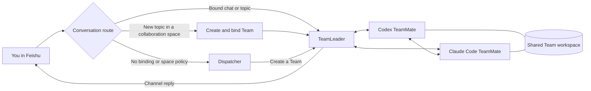

<div align="center">

# Dreamux

### Your agents. One workspace. A conversation away.

Run persistent AI teams from Feishu, powered by Codex and Claude Code.

[](https://www.npmjs.com/package/@excitedjs/dreamux)
[](https://github.com/excitedjs/dreamux/actions/workflows/ci.yml)
[](packages/dreamux/package.json)
[](LICENSE)

[Get started](docs/getting-started.md) · [User guide](docs/usage.md) · [Configuration](docs/configuration.md) · [Documentation](docs/README.md)

</div>

---

Dreamux brings coding agents into the conversations where work begins. Send a
request in Feishu, give it a repository, and let a TeamLeader coordinate the
work with specialist TeamMates. Follow up in the same topic to refine the task,
review a result, or pick up where you left off.

The host runs on your machine. Your agents work in real directories, use their
native runtime sessions, and can share a workspace or use managed Git worktrees.
One Node.js process can host multiple Dispatchers, with Codex and Claude Code
runtimes available to their teams.

## From a message to a working team

> “Investigate the failing build in this repository. Have one teammate trace
> the failure and another review the proposed fix. Bring me the evidence.”

Give the request to a Dispatcher, or open a topic in a configured collaboration
space. A TeamLeader can delegate parallel investigations, collect results, and
coordinate the next step. You can send corrections while work is running; the
selected runtime controls how those inputs join its current work.



## Built for work that continues

| Capability | What it means in practice |
| --- | --- |
| **Persistent teams** | Named TeamMates keep their identity and session history across follow-ups; closed members can be reopened. |
| **Mixed runtimes** | Use configured Codex and Claude Code runtimes in the same team, with separate roles and instructions. |
| **Conversation routing** | Bind a chat or topic to a Team. Configure a collaboration space to create a Team for each new topic. |
| **Shared workspaces** | Team members see the same files. Managed Git worktrees provide optional workspace separation between tasks. |
| **Visible collaboration** | Inspect recent member activity, exchange messages within the team, and receive results back in the owning conversation. |
| **Scheduled follow-ups** | Durable cron jobs submit prompts to a Dispatcher or TeamLeader, including while it is working. |
| **Programmable workflows** | Run bounded parallel work and staged review through the bundled dynamic workflow tools. |
| **Extensible by design** | Runtime providers, channel providers, and lifecycle plugins extend a host built around neutral contracts. |

Dreamux supplies orchestration, routing, and lifecycle management. The selected
agent runtime supplies the model, tools, authentication, and execution policy.
Running the host locally does not make model inference offline.

## Get started

You need **Node.js 22.7+**, an installed and authenticated **Codex 0.137+** or
**Claude Code** CLI, and a **Feishu bot application** with long-connection events
configured. See the [setup guide](docs/getting-started.md) for the complete
checklist and first-message pairing flow.

```bash
npm install --global @excitedjs/dreamux
dreamux onboard
dreamux doctor
dreamux status
```

The interactive wizard asks for a workspace, runtime, and Feishu credentials.
It can register and start a user service on Linux or macOS. If you choose
foreground operation instead, start it with `dreamux serve` before checking
status.

Then message your bot in Feishu. Complete the App Owner pairing approval, and
send your first task. In groups, @-mention the bot by default.

**Building from a checkout?** Use the [Rush-based source setup](docs/development.md)
instead of installing inside individual packages.

## Learn your way around

| I want to… | Read |
| --- | --- |
| Install Dreamux and connect a bot | [Getting started](docs/getting-started.md) |
| Work with teams, topics, and scheduled tasks | [Everyday usage](docs/usage.md) |
| Configure runtimes, workspaces, and access | [Configuration](docs/configuration.md) |
| Check service health, upgrade, or debug a problem | [Operations and troubleshooting](docs/operations.md) |
| Understand the host and build extensions | [Architecture and extensions](docs/architecture.md) |
| Build, test, and contribute | [Development](docs/development.md) |

## A few boundaries worth understanding

- **A Dispatcher is a trust boundary.** Chats handled by its agent share context.
  Use separate Dispatchers for unrelated private conversations.
- **Workspace separation is explicit.** Isolation is off by default; Team
  members share their Team's directory. A Git worktree is not a security sandbox.
- **Sessions persist; inbound queues do not.** A restart can recover recorded
  agents and Teams, but unprocessed inbound messages are held only in memory.
- **Replies use channel tools.** Agent output is not automatically posted to
  chat. Feishu provides explicit replies, interactive cards, and activity views.

The built-in channel is Feishu. The built-in runtimes are Codex and Claude Code.
Dreamux currently runs as a local host with CLI administration; it does not ship
a web dashboard or cross-machine orchestration.

## Contributing

Development targets the `next` branch. Start with the
[development guide](docs/development.md) and [repository rules](CLAUDE.md).
Maintainers and coding agents can find the deeper design record in the
[knowledge base](.agents/root.md).

Built as the successor to [claudemux](https://github.com/excitedjs/claudemux).
Released under the [MIT License](LICENSE).
