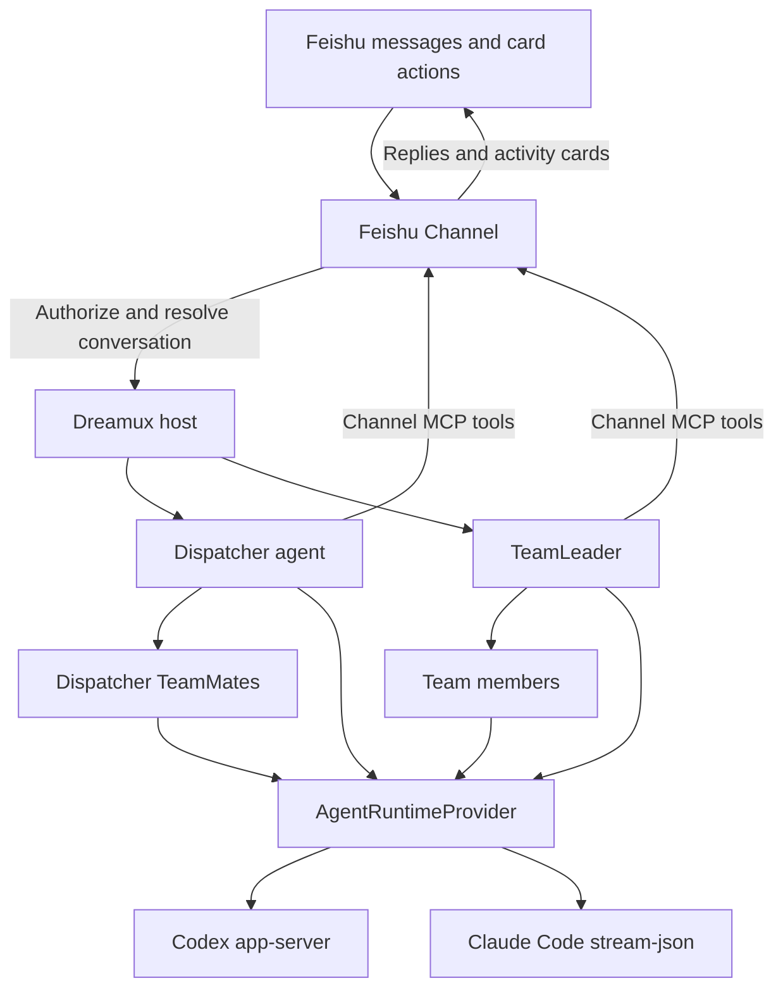

# Architecture and extensions

[Documentation](README.md) / Architecture and extensions

Dreamux is a local orchestration host. It owns agent and Team lifecycles,
workspaces, scheduling, and administration. Runtime providers own the agent
engines; channel providers own the conversation experience.

## How a request reaches an agent



The channel decides which conversation reaches which Team. Core receives the
chosen recipient through its neutral channel boundary; it does not interpret
Feishu chat/topic identifiers or maintain a second routing table.

Each agent uses a runtime provider through the same neutral interface. The
provider owns starting and resuming native sessions, admitting new input,
reporting activity and completion, stopping processes, and reading history.
Dreamux retains the identity and checkpoints needed to reconstruct its objects.

A TeamLeader and its members share one Team directory but have separate runtime
sessions. Native completion reports return to the member's actual owner. Ordinary
member-to-member messaging stays within that owner's collection; it does not
create a global agent address space.

## Package map

| Package | Owns |
| --- | --- |
| [`@excitedjs/dreamux`](../packages/dreamux) | Host, CLI, config, admin socket, orchestration services, bundled skills |
| [`@excitedjs/dreamux-types`](../packages/dreamux-types) | Neutral runtime, channel, plugin, activity, and command contracts |
| [`@excitedjs/dreamux-utils`](../packages/dreamux-utils) | Shared runtime utilities |
| [`@excitedjs/agent-runtime-codex`](../packages/agent-runtime/codex) | Codex app-server protocol, native history, and runtime configuration |
| [`@excitedjs/agent-runtime-claude-code`](../packages/agent-runtime/claude-code) | Resident Claude Code stream-json process and native sessions |
| [`@excitedjs/feishu-channel`](../packages/channel/feishu-channel) | Feishu access, routing, Teams-by-topic, cards, and channel tools |
| [`@excitedjs/feishu-transport`](../packages/channel/feishu-transport) | Feishu SDK I/O and event projection |
| [`@excitedjs/dreamux-plugin-bootstrap`](../packages/plugins/bootstrap) | Unpublished workspace-profile plugin used in repository development |
| [`@excitedjs/eslint-config`](../packages/eslint-config) | Private shared source-quality rules |

Provider packages depend on the neutral contracts and shared utilities. They do
not import host internals. A new runtime or channel should implement its provider
contract instead of adding provider-specific branches to core.

## MCP surfaces and skills

Dreamux supplies role-scoped MCP servers to the selected runtime. Their stdio
shims communicate with the host over its local admin socket. There is no public
HTTP MCP listener required for the default setup.

| Surface | Typical operations |
| --- | --- |
| `teammate` | Spawn, send, inspect, close, recover members; run and observe workflows |
| `team` | Dispatcher creation and coordination of Teams; TeamLeader self-dissolution |
| `cron` | Create, list, update, and delete the calling agent's scheduled prompts |
| Channel-owned server | Reply, react, ask questions, bind conversations, and manage channel features |

Available tools depend on the caller's role. Ordinary TeamMates have a narrower
messaging/inspection surface than their owner. A TeamLeader manages its own Team
members; it does not receive the Dispatcher's full cross-Team control surface.
Use the live tool metadata as the authority for arguments and availability.

Bundled skills provide the agent-side operating guidance:

- [Dispatcher workflow](../packages/dreamux/skills/dispatcher/dispatcher-workflow/SKILL.md)
  covers delegation and Team coordination.
- [Dreamux maintenance](../packages/dreamux/skills/dispatcher/dreamux-maintenance/SKILL.md)
  covers configuration and service operations.
- [Teamwork](../packages/dreamux/skills/team-leader/teamwork/SKILL.md)
  covers delegation and follow-ups inside a Team.
- [Dynamic Workflow](../packages/dreamux/skills/shared/dynamic-workflow/SKILL.md)
  covers scripted orchestration for Dispatchers and TeamLeaders.

These skills are injected at runtime. Onboarding does not copy them into a
workspace skill directory.

## Write a plugin

A plugin package exports a synchronous factory returning `DreamuxPlugin` from
`@excitedjs/dreamux-types`. A small instruction plugin looks like this:

```ts
import type { DreamuxPlugin } from '@excitedjs/dreamux-types';

export default function createPlugin(): DreamuxPlugin {
  return {
    name: 'review-guidance',
    server(host) {
      host.hooks.dispatcher.tap('review-guidance', (dispatcher) => {
        dispatcher.hooks.launch.tap('review-guidance', (draft) => {
          draft.instructions.push(
            'When reporting a code review, include concrete evidence for each finding.',
          );
        });
      });
    },
  };
}
```

This adds guidance to the Dispatcher agent at launch. TeamLeader guidance belongs
on a Team's `leaderLaunch` hook; ordinary member guidance belongs on
`teammateLaunch`.

The plugin lifecycle has distinct responsibilities:

| Entry point | Responsibility |
| --- | --- |
| Factory | Return the plugin object synchronously |
| `config.read(raw)` | Validate that plugin's config synchronously |
| `contribute(host)` | Register runtime or channel providers |
| `server(host)` | Register lifecycle hooks and plugin integrations |
| Hook callbacks | Perform work when the owning object reaches that lifecycle event |

Factories, config readers, `contribute`, and `server` must not return promises.
`contribute` and `server` register behavior; they do not start resources, perform
I/O, or create timers. `doctor` runs them too, potentially while a daemon is
already live. Put resource ownership in the appropriate lifecycle instead.

Plugins can contribute providers, append instructions and skill roots, influence
Team creation, and publish typed APIs to other plugins. Feishu also exposes an
extension API for additional channel tools and card actions. The authoritative
interfaces are in
[`plugin.ts`](../packages/dreamux-types/src/plugin.ts) and the
[Feishu package documentation](../packages/channel/feishu-channel/README.md).

Install the package so Dreamux can resolve it, then add its reference to
[`plugins[]`](configuration.md#plugins-and-external-providers). Plugin code runs
inside the host process. A provider reference and a plugin reference have
different contracts: a provider implements one engine or channel, while a plugin
can contribute providers and participate in lifecycle hooks.

The repository's bootstrap plugin is a concrete example. It reads user-owned
workspace profile files and adds them to launch instructions. It is unpublished
and unavailable in ordinary npm Dreamux installations.

## State and trust boundaries

Configuration belongs to the operator. Durable identities and Team records
belong to core; conversation bindings and access transitions belong to the
channel; native session history belongs to the runtime. The host supplies paths
and persistence capabilities without making one layer reinterpret another's
records.

The [operations guide](operations.md#find-logs-and-state) explains which paths
are durable and which are rebuildable. For source-level ownership maps, start at
[current architecture](../.agents/domains/current-architecture.md). The knowledge
base explains design intent; current source decides actual behavior.
